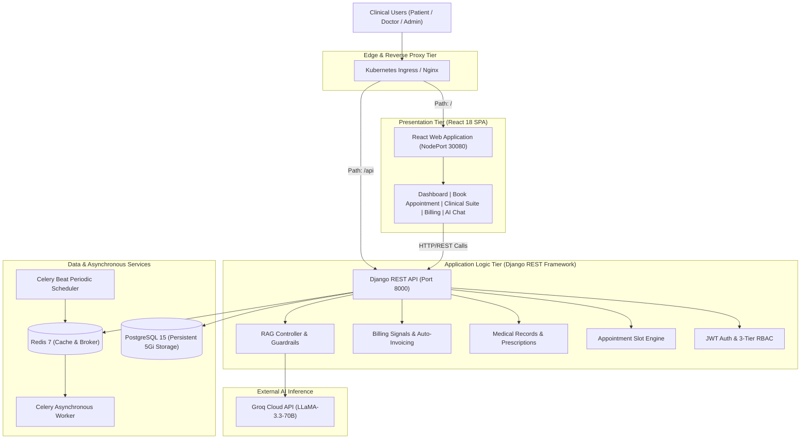
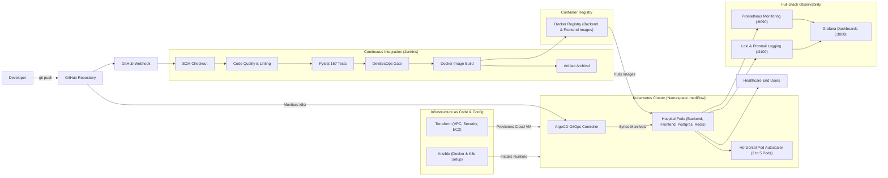

# MediFlow-AI — System Architecture Diagrams
**Course:** DevOps & Automation Lab (ENSP461) — Capstone Project  
**Application:** MediFlow-AI (Smart Clinical Suite & DevOps Pipeline)

---

## 1. Multi-Tier Application Architecture

This diagram illustrates the clinical request flow across frontend, backend, database, cache, background workers, and AI services:



---

## 2. End-to-End DevOps CI/CD Pipeline Architecture

This diagram illustrates the automated lifecycle from developer commit to production Kubernetes cluster:



---

## 3. Zero-Downtime Blue-Green Deployment Topology

This diagram demonstrates how Blue-Green deployment enables 100% zero-downtime updates:

```
                    [ Incoming User Traffic ]
                               │
                               ▼
            [ Router Service: backend-blue-green-service ]
                               │
             ┌─────────────────┴─────────────────┐
             │ Current Active                    │ Staged & Ready
             ▼ (Selector: version=blue)          ▼ (Selector: version=green)
     [ Blue Deployment ]                 [ Green Deployment ]
    Version: 1.0.0 (Live)               Version: 2.0.0 (Tested)
    Replicas: 2 Pods                    Replicas: 2 Pods
    Handling All Patient Traffic        Ready for Instant Cutover
```

*Traffic Switch Command:*
```bash
kubectl patch service backend-blue-green-service -n mediflow -p '{"spec":{"selector":{"version":"green"}}}'
```
*Result:* Traffic immediately points to Green without dropping a single active connection or restarting containers.

---

## 4. Kubernetes Cluster Namespace (`mediflow`) Resource Topology

```
Namespace: mediflow
├── Config & Secrets
│   ├── ConfigMap: mediflow-config (DB Hosts, Redis URLs, CORS)
│   └── Secret: mediflow-secrets (Base64 Encrypted Passwords)
│
├── Storage Tier
│   ├── PersistentVolume: postgres-pv (5Gi Storage)
│   └── PersistentVolumeClaim: postgres-pvc
│
├── Workloads (Deployments)
│   ├── postgres-deployment (1 Replica)
│   ├── redis-deployment (1 Replica)
│   ├── backend-deployment (2 Replicas, Auto-Scales to 5 via HPA)
│   ├── celery-worker-deployment (1 Replica)
│   └── frontend-deployment (2 Replicas)
│
├── Networking & Routing
│   ├── Service: postgres-service (ClusterIP: 5432)
│   ├── Service: redis-service (ClusterIP: 6379)
│   ├── Service: backend-service (ClusterIP: 8000)
│   ├── Service: frontend-service (NodePort: 30080)
│   └── Ingress: mediflow-ingress (Routes /api to Backend, / to Frontend)
│
└── Governance & GitOps
    ├── HPA: backend-hpa (CPU target: 70%)
    └── ArgoCD Application: mediflow-ai (Automated Self-Healing)
```
